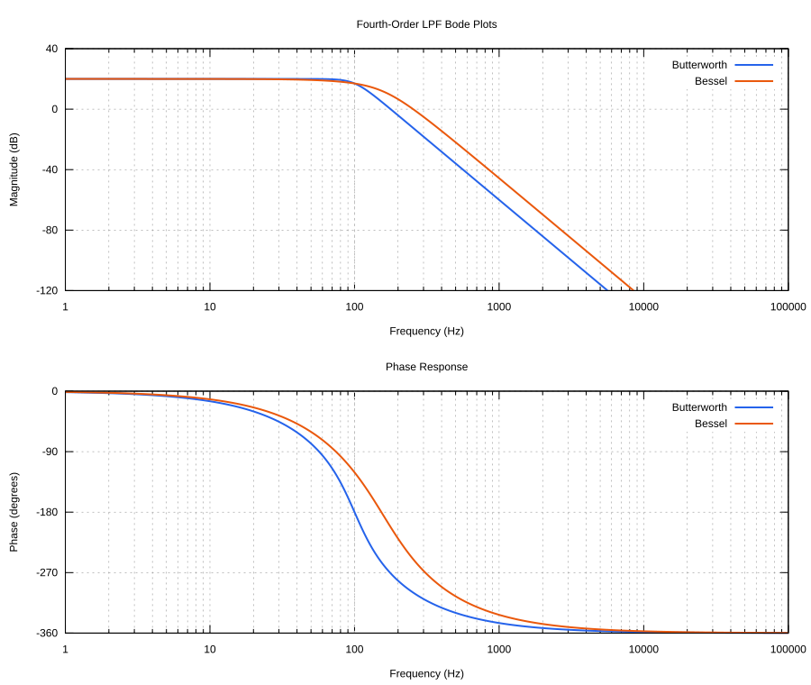
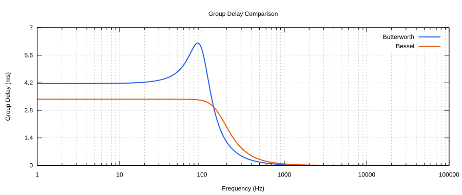
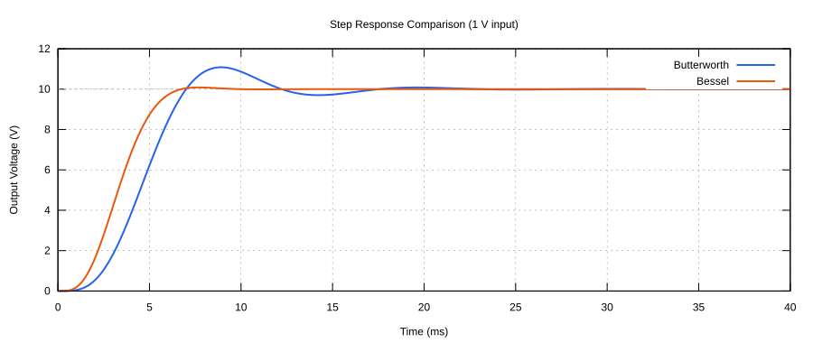
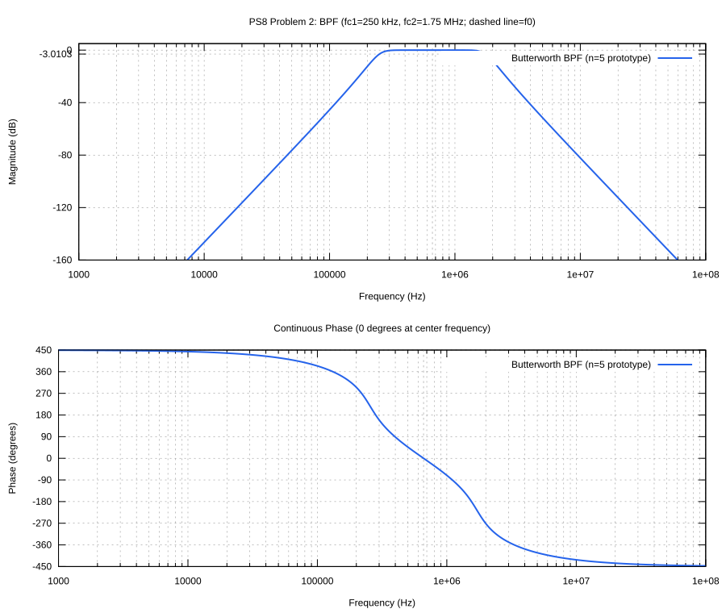

# EEL 3112 — Circuits 2 Problem Sets

University of Florida · Fall 2026 · Bohdan Purtell

## Problem Set 8

[Assignment PDF](ps8/ps8_problems.pdf) ·
[PS8 README and run instructions](ps8/README.md) ·
[Problem 1 source](ps8/bin/ps8_problem1.ml) ·
[Problem 2 source](ps8/bin/ps8_problem2.ml)

The plots below are included for grading and can be viewed without running the
code. Click an image to open the full-size SVG. The programs are written in
OCaml; Problem 2 also includes a commented MATLAB equivalent.

### Problem 1 — Butterworth vs. Bessel low-pass filters

Fourth-order filters with a **100 Hz cutoff** and **DC gain of 10**.

#### Part B — Bode magnitude and phase

#### Part C — Group delay

#### Part D — Step response

Response to a 1 V step input; the final output is 10 V.

### Problem 2 — Butterworth band-pass filter

Fifth-order Butterworth prototype, transformed to a band-pass filter with unity
center gain and a tenth-degree denominator.

| Quantity | Value |
| --- | --- |
| Lower cutoff | 250 kHz |
| Bandwidth | 1.5 MHz |
| Upper cutoff (Part C) | 1.75 MHz |
| Center frequency (Part D) | 661.438 kHz |

#### Part B — Bode magnitude and phase

The dashed line marks the center frequency.

